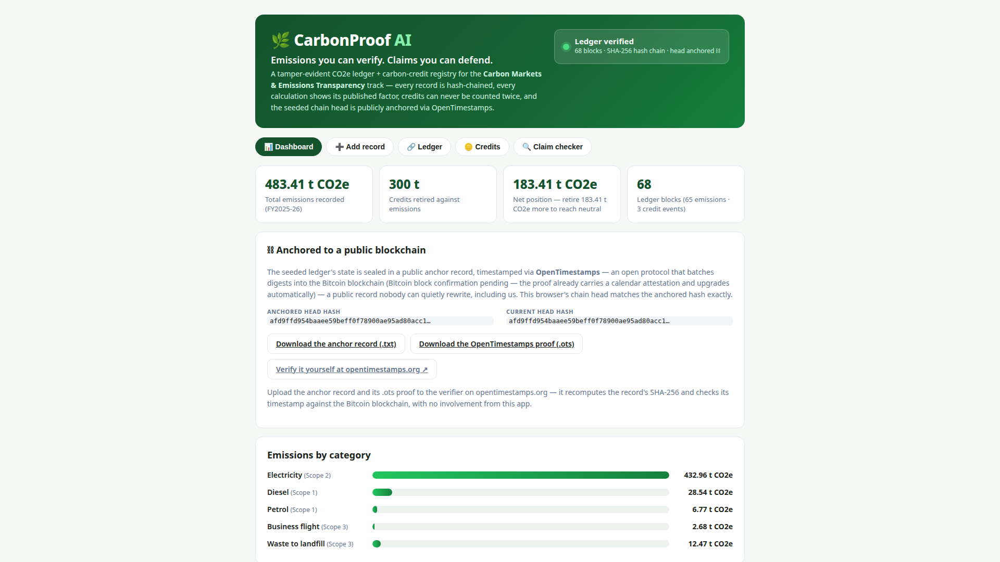
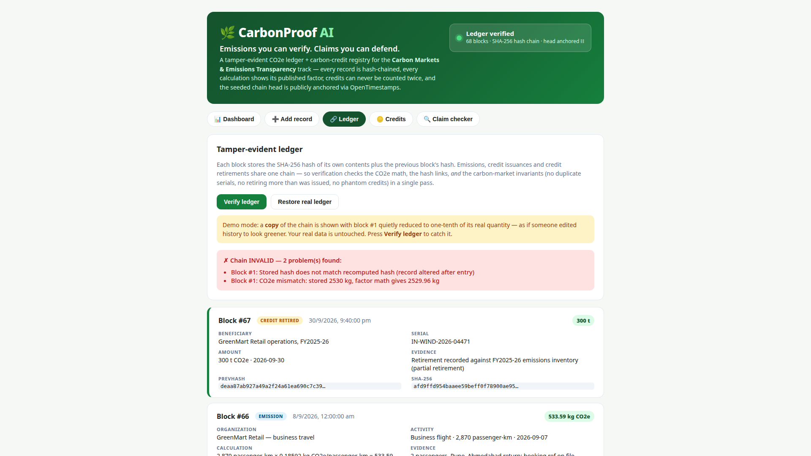
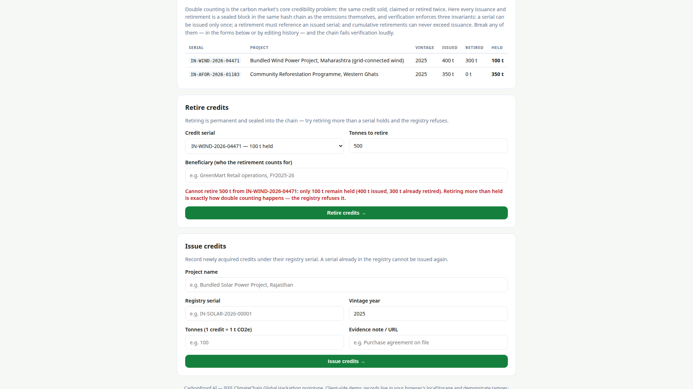
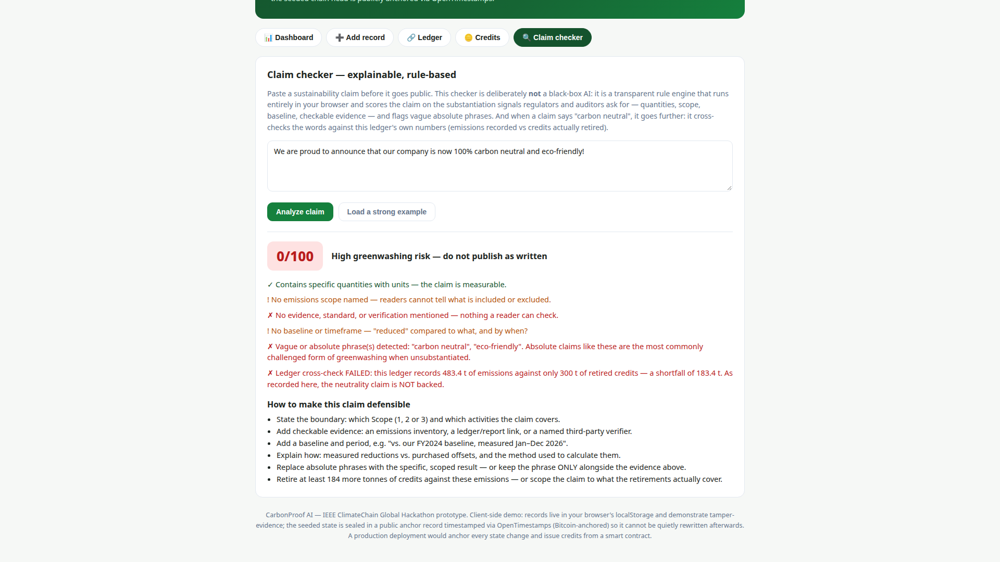
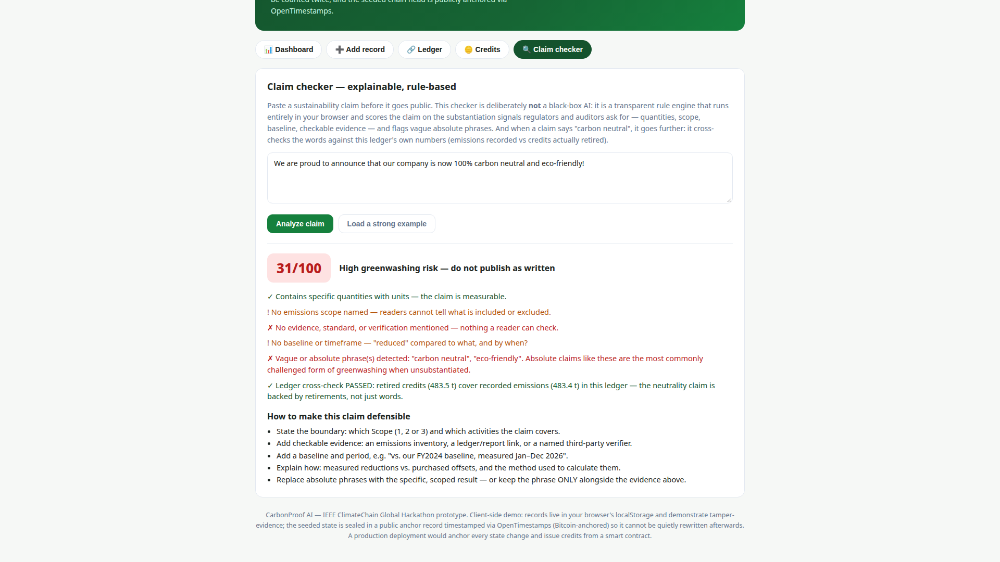
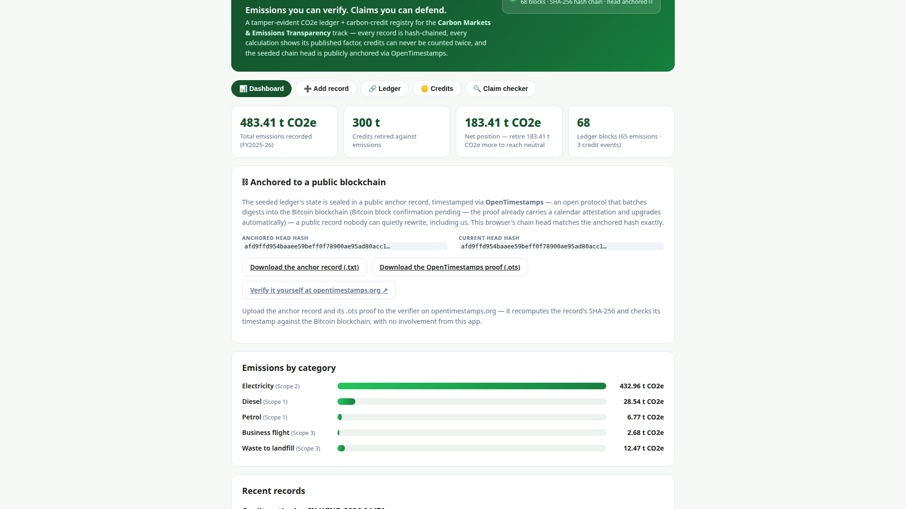
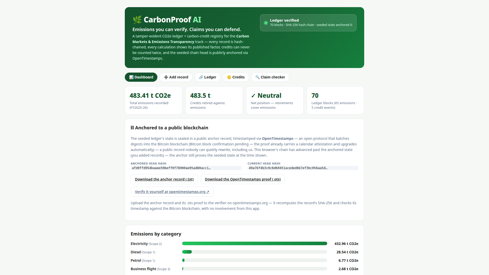

<div align="center">

# CarbonProof AI

**Emissions you can verify. Claims you can defend.**

A tamper-evident CO2e ledger and carbon-credit registry with an explainable
claim checker — built for the **IEEE ClimateChain Global Hackathon**,
track **Carbon Markets & Emissions Transparency**.

[](https://carbonproof-ai.vercel.app)
[](https://sepolia.etherscan.io/address/0xEeDa0d764654798Fb25e3981Be236A75edCF0a8e)
[](#5-public-anchoring)
[](#testing)

[**Live demo**](https://carbonproof-ai.vercel.app) ·
[**Verified contract (Sepolia)**](https://sepolia.etherscan.io/address/0xEeDa0d764654798Fb25e3981Be236A75edCF0a8e) ·
[**Devpost submission**](https://devpost.com/software/carbonproof-ai-5eh0d3) ·
[**Demo video (3:01)**](https://youtu.be/rUkR5qO4xlM)

</div>

[](https://youtu.be/rUkR5qO4xlM)

---

## The problem

Carbon markets run on trust they haven't earned. Companies record emissions
in spreadsheets anyone can quietly edit, publish totals as static PDFs, and
announce "carbon neutrality" backed by credits that may have been counted
twice — double counting is named in this track's own problem statement.
Auditors, regulators, and buyers have no cheap way to answer three basic
questions:

1. **Was this emissions record changed after it was entered?**
2. **Do the claimed credits actually exist — and were they retired only once?**
3. **Is this green claim substantiated — or is it greenwashing?**

CarbonProof AI is a working prototype that answers all three.

## How it works

Emissions, credit issuances, and credit retirements are sealed into **one
SHA-256 hash chain**, so every claim the system makes can be checked in a
single verification pass — in the app, and now also on-chain.

### 1. Tamper-evident emissions ledger

Each record is converted to CO2e with a *published, cited* emission factor
(shown inside every record's calculation) and sealed as a hash-chained
block. **Verify ledger** recomputes every hash, link, and CO2e figure and
names the exact block that was altered. A demo-only tamper simulation edits
a *copy* of the chain, so reviewers can watch fraud get caught safely.



### 2. Credit registry with a double-counting guard

Credits are issued under unique registry serials and retired against
emissions — as sealed blocks in the same chain. Verification enforces the
market's core invariants: a serial can be issued only once; retirements
must reference an issued serial; cumulative retirements can never exceed
issuance. The dashboard shows the live net position (emissions − retired),
and credits can be retired live to watch it reach neutral.



### 3. On-chain enforcement — CarbonRegistry (Ethereum Sepolia)

The registry is mirrored by a Solidity smart contract, deployed on the
Ethereum Sepolia testnet with **source verified (exact match)**:

| | |
| --- | --- |
| Contract | [`0xEeDa0d764654798Fb25e3981Be236A75edCF0a8e`](https://sepolia.etherscan.io/address/0xEeDa0d764654798Fb25e3981Be236A75edCF0a8e) |
| Seeded state | 750 t issued · 300 t retired · 450 t held — identical to the app |
| Anchor tx | [Ledger head anchored on-chain](https://sepolia.etherscan.io/tx/0x03ff6481af01ad3507401f8f2987641b77afb279c1a561d7b474cff9fb4e9c81) |
| Tests | 13 Hardhat tests covering both guards, incl. the over-retirement refusal |

The contract enforces the same rules at network level, where no app
operator can override them: `issue()` reverts on a duplicate serial,
`retire()` reverts if retirements would exceed issuance, and
`anchorLedgerHead()` commits the ledger's head hash on-chain. Source,
tests, and the deployment record live in [`contracts/`](contracts/).

### 4. Explainable claim checker

A transparent rule engine (deliberately *not* a black-box AI — it runs
fully locally) scores a draft claim 0–100 on substantiation signals:
quantities, scope, baseline, evidence. For neutrality claims it goes
further and cross-checks the words against the ledger itself: retirements
must cover recorded emissions, or the claim fails — with the exact
shortfall named.

| The claim fails, shortfall named | Retire the credits — the claim passes |
| --- | --- |
|  |  |

### 5. Public anchoring

The seeded ledger's state is sealed in a public anchor record
([`public/carbonproof-anchor.txt`](public/carbonproof-anchor.txt)) whose
SHA-256 is timestamped via **OpenTimestamps** into the **Bitcoin
blockchain** — confirmed in **block 972682**. Anyone can recompute the
ledger head hash from this repo and verify the timestamp independently at
opentimestamps.org: the seeded history cannot be quietly rewritten
afterwards, not even by us. The same head hash is also anchored in the
Sepolia contract (above), so the state is committed on two public chains.



<div align="center">



*The full arc in the demo: retire credits against the seeded year and the
dashboard reaches ✓ Neutral — and the claim checker agrees.*

</div>

## Track alignment

The track calls for blockchain-based carbon-credit verification,
transparent emissions tracking, and mechanisms that prevent double
counting. CarbonProof AI implements exactly that stack in miniature:
hash-chained tracking, a serial-based credit registry whose verification
*enforces* the no-double-counting invariant, a deployed smart contract
enforcing the same invariant on a public testnet, and a Bitcoin anchor —
in a form a small organization can actually use today.

## Features

- **Record entry + CSV import** — single records or bulk spreadsheet
  import (template included); invalid rows are reported, never swallowed.
- **Transparent calculation** — `quantity × factor = kg CO2e` shown in
  every record; factors pinned to published sources (below).
- **One-click verification** — hashes, links, CO2e math *and* credit
  invariants, with precise per-block error reports.
- **Credit lifecycle** — issue / hold / retire with the double-counting
  guard enforced in the UI, in chain verification, and on-chain.
- **Dual public anchoring** — Bitcoin via OpenTimestamps, plus the ledger
  head committed in the Sepolia contract.
- **Claim checker** — substantiation score, flagged phrases, improvement
  suggestions, and the ledger cross-check for neutrality claims.
- **Dashboard** — totals, net position, per-category breakdown, live
  integrity status, anchor status, recent activity.
- **Seeded dataset** — a full financial year (FY2025-26) for a mid-size
  retailer: 65 emissions records (483.41 t CO2e) + 750 t of credits
  issued, 300 t retired. Deterministic, so the chain head is reproducible.
- **Export** — full ledger (with hashes) as JSON or CSV for auditors.

## Architecture

```
src/
  data/emissionFactors.js   — published factors with named sources
  data/anchor.json          — public-anchor metadata shown in the app
  lib/sha256.js             — pure-JS SHA-256 (FIPS 180-4), no dependencies
  lib/ledger.js             — CO2e math, emissions + credit blocks,
                              chain & invariant verification, seeded data
  lib/claimChecker.js       — rule-based claim scoring + ledger cross-check
  lib/csvImport.js          — activity CSV parsing/validation
  App.jsx                   — React UI (dashboard / add / ledger / credits / claims)
public/
  carbonproof-anchor.txt    — anchor record sealing the seeded ledger state
  anchor.ots                — OpenTimestamps proof for that record
contracts/
  contracts/CarbonRegistry.sol — on-chain registry (Sepolia, verified)
  test/                     — Hardhat suite for the double-count guards
  scripts/deploy.js         — deploy + seed + anchor, asserts final totals
tests/logic.test.mjs        — SHA-256 vectors, chain validity, tamper
                              detection, credit-invariant tests, claim
                              cross-check, CSV import tests
docs/images/                — the screenshots used in this README
```

The app runs fully client-side: React + Vite, no backend, no login, no API
keys. The contract is a separate Hardhat project under `contracts/`.

## Quick start

```bash
npm install
npm run dev        # development server (Vite prints the local URL)
npm run build      # production build → dist/ (static site, deploy anywhere)
npm run preview    # serve the production build locally
```

Smart contract:

```bash
cd contracts
npm install
npx hardhat test   # 13 tests, all passing
# Deployment is via scripts/deploy.js with SEPOLIA_RPC_URL and
# DEPLOYER_PRIVATE_KEY in the environment — see contracts/README.md
```

## Testing

- **App logic** — `node tests/logic.test.mjs`: SHA-256 test vectors, chain
  validity, tamper detection, credit-invariant enforcement, claim
  cross-check, CSV import validation. All passing.
- **Contract** — `npx hardhat test` (in `contracts/`): issuance and
  totals, duplicate-serial revert, zero-amount reverts, non-admin reverts,
  partial-retirement accounting, the over-retirement scenario (issue
  400,000 kg → retire 200,000 kg → retire 500,000 kg reverts), full
  retirement of the remainder, ledger-head anchoring. **13/13 passing.**

## Emission factors (published, cited)

| Category | Unit | Factor (kg CO2e/unit) | Source |
|---|---|---|---|
| Electricity | kWh | 0.727 | CEA (India) CO2 Baseline Database, FY 2023-24 grid weighted average |
| Diesel | litres | 2.5128 | UK DESNZ GHG Conversion Factors 2024 (average biofuel blend) |
| Petrol | litres | 2.0844 | UK DESNZ GHG Conversion Factors 2024 (average biofuel blend) |
| Business flight | passenger-km | 0.18592 | UK DESNZ 2024, short-haul economy incl. radiative-forcing uplift |
| Waste to landfill | kg | 0.467 | UK DESNZ 2024, commercial & industrial waste to landfill (467 kg/t) |

## Limitations (honest list)

- **Client-side demo.** App records live in the visitor's browser
  (localStorage); the anchors seal the *seeded* state, not later edits.
  The registry's smart-contract mirror is a Sepolia **testnet** prototype
  seeded with the same state — a production deployment would run the
  registry on mainnet and anchor every state change, not just genesis.
- **Tamper-evidence ≠ tamper-proofing.** The chain + public anchors make
  edits *detectable against independent commitments*; they do not make
  edits impossible on a private copy.
- **Credit serials in the seeded dataset are illustrative** (the dataset
  is a realistic prototype, not a real company's registry extract).
- **Claim checker is a heuristic**, not an LLM and not legal advice: it
  detects missing substantiation and ledger mismatches; it cannot verify
  that entered activity data reflects the real world.

## Roadmap

1. **Smart-contract registry — SHIPPED (testnet).** CarbonRegistry is live
   on Ethereum Sepolia with the double-counting guard enforced by the
   network; remaining steps are a mainnet deployment and per-change
   anchoring.
2. **Per-change anchoring** — anchor every ledger state transition
   (Merkle root per period) instead of only the genesis state.
3. **Evidence hashing** — hash bills/meter photos into blocks so evidence
   is covered by the same tamper-evidence.
4. **Versioned factor library** — more regions/years, factor version
   sealed into each block.
5. **Team mode + optional LLM second pass** on the claim checker, layered
   over the transparent rule score.

---

<div align="center">

**CarbonProof AI** — built solo for the IEEE ClimateChain Global Hackathon.

[Live demo](https://carbonproof-ai.vercel.app) ·
[Devpost](https://devpost.com/software/carbonproof-ai-5eh0d3) ·
[Verified contract](https://sepolia.etherscan.io/address/0xEeDa0d764654798Fb25e3981Be236A75edCF0a8e) ·
[Demo video](https://youtu.be/rUkR5qO4xlM)

</div>
